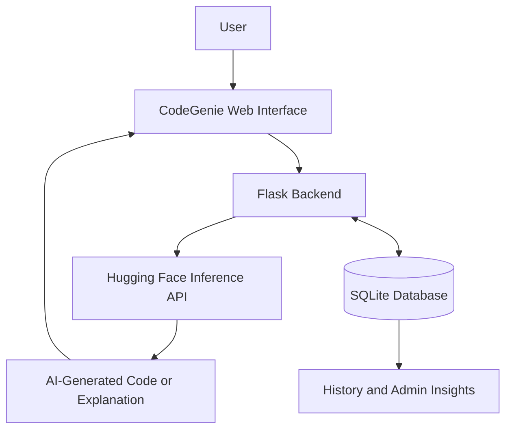

<!--
  CodeGenie AI — Project README
  Keep this file updated as the application evolves.
-->

<div align="center">

# ✨ CodeGenie AI

### AI-Powered Code Explainer & Code Generator

**Turn natural-language ideas into code. Understand code one step at a time.**

<p>
  
  
  
  
</p>

<p>
  <a href="https://ai-codegenie.onrender.com"><strong>🚀 Live Demo</strong></a>
  ·
  <a href="https://github.com/vyshnaviMoka/AI-CodeGenie"><strong>💻 Explore Repository</strong></a>
  ·
  <a href="https://github.com/vyshnaviMoka/AI-CodeGenie/issues">Report an Issue</a>
</p>

</div>

---

## 🌐 Live Deployment

**Try CodeGenie AI:** [https://ai-codegenie.onrender.com](https://ai-codegenie.onrender.com)

> Note: The live application may take a short time to wake up if the hosting service has been idle.

## ## 🔐 Admin Dashboard Demo Access

Anyone can try the CodeGenie Admin Dashboard using these demo credentials:

- **Email:** `admin@gmail.com`
- **Password:** `admin123`

**Live Website:** https://ai-codegenie.onrender.com

**Note:** These are public demo credentials. Change the default password before using the application with real users or sensitive data.

## 🌟 About the Project

**CodeGenie AI** is a web application designed to make coding easier with generative AI. Users can describe a programming task in natural language to generate code, or submit code to receive a step-by-step explanation.

The application combines a Flask backend, a browser-based interface, database-backed user features, and the Hugging Face inference API in one project.

## 🚀 Features

<table>
  <tr>
    <td width="50%">
      <h3>⚡ AI Code Generation</h3>
      Describe a task and request code in your selected programming language.
    </td>
    <td width="50%">
      <h3>📘 Code Explanation</h3>
      Get a step-by-step explanation to help understand code and its logic.
    </td>
  </tr>
  <tr>
    <td width="50%">
      <h3>🔐 User Authentication</h3>
      Register and sign in to access the coding dashboard.
    </td>
    <td width="50%">
      <h3>🗂️ Generation History</h3>
      Save prompts and generated outputs in the application database.
    </td>
  </tr>
  <tr>
    <td width="50%">
      <h3>📊 Admin Dashboard</h3>
      Review application usage, user activity, feedback, and language statistics.
    </td>
    <td width="50%">
      <h3>💬 User Feedback</h3>
      Submit ratings and feedback through the application.
    </td>
  </tr>
</table>

## 🧰 Tech Stack

| Area | Technologies |
|---|---|
| Backend | Python, Flask, Flask-Login |
| Frontend | HTML, CSS, JavaScript, Jinja templates |
| Database | SQLite, Flask-SQLAlchemy, SQLAlchemy |
| AI integration | Hugging Face Inference API |
| AI model | `Qwen/Qwen2.5-Coder-7B-Instruct` |
| Deployment setup | Gunicorn, Procfile |

## 🏗️ Project Structure

```text
AI-CodeGenie/
├── backend/
│   ├── app.py             # Main Flask application and routes
│   ├── auth.py            # Registration, login, and logout
│   ├── database.py        # SQLAlchemy database setup
│   └── models.py          # Application database models
├── static/                # CSS, JavaScript, and static assets
├── templates/             # HTML/Jinja page templates
├── requirements.txt       # Python dependencies
├── Procfile               # Web server startup configuration
├── LICENSE                # MIT license
└── README.md
```

## 🔄 How It Works



1. The user signs in and opens the coding dashboard.
2. The user enters a prompt or code and selects the desired action.
3. Flask sends the request to the Hugging Face inference endpoint.
4. The AI response is displayed in the interface.
5. Generation records and application activity support history and dashboard insights.

## 💻 Getting Started

Follow these steps to run the project locally.

### Prerequisites

- Python installed on your computer
- Git
- A Hugging Face access token for AI requests

### 1. Clone the repository

```bash
git clone https://github.com/vyshnaviMoka/AI-CodeGenie.git
cd AI-CodeGenie
```

### 2. Create a virtual environment

**Windows (PowerShell)**

```powershell
py -m venv .venv
.venv\Scripts\Activate.ps1
```

**macOS / Linux**

```bash
python3 -m venv .venv
source .venv/bin/activate
```

### 3. Install dependencies

```bash
python -m pip install -r requirements.txt
```

### 4. Configure your API token

Create a file named `.env` in the project root and add your own Hugging Face token:

```env
HUGGINGFACE_API_TOKEN=your_hugging_face_token_here
```

Create or manage a token at [Hugging Face Settings](https://huggingface.co/settings/tokens).

> 🔒 **Security:** Keep your token private. Never paste it into source code or commit your `.env` file to GitHub.

### 5. Run the application

From the repository root, run:

```bash
python -m backend.app
```

Open [http://127.0.0.1:5000](http://127.0.0.1:5000) in your browser if Flask starts on the default local port.

## 🧪 Notes

- AI-generated code may be incorrect or incomplete. Review and test it before using it.
- AI requests require a valid Hugging Face token and access to the configured model.
- Keep credentials and local database files out of version control.
- The commands above describe a local development setup; they do not guarantee that a hosted deployment is currently available.

## 🎯 What This Project Demonstrates

- Full-stack web application development
- REST/API integration with a generative AI service
- User authentication and role-aware pages
- Database-backed application features
- Usage insights and feedback workflows
- Environment-based configuration and deployment setup

## 👩‍💻 Author

**Vyshnavi Moka**

- GitHub: [@vyshnaviMoka](https://github.com/vyshnaviMoka)
- Project: [AI-CodeGenie](https://github.com/vyshnaviMoka/AI-CodeGenie)

## 📄 License

This project is distributed under the MIT License. See the [LICENSE](LICENSE) file for details.

---

<div align="center">

**Built to make coding and learning a little easier.** ✨

</div>
